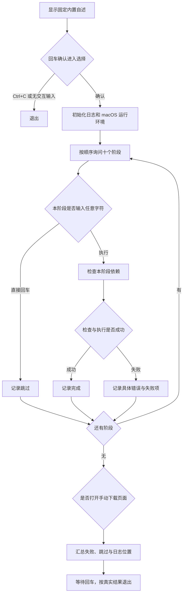
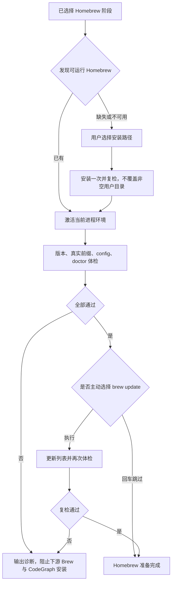
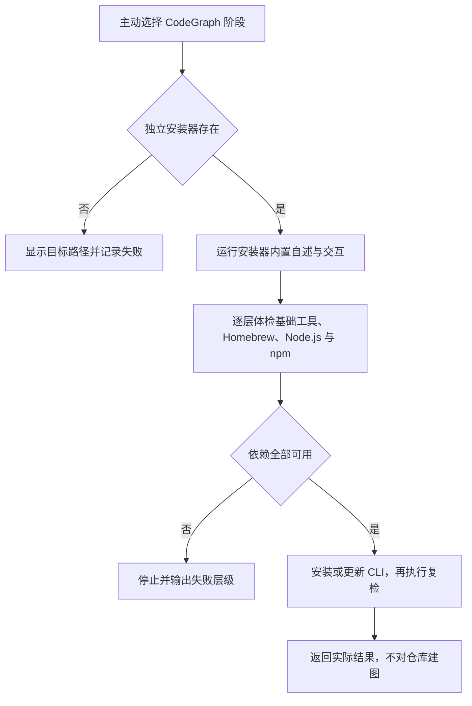

# Jobs 多平台新系统配置


<!-- jobs-toc:start -->
<!-- jobs-toc:source {"v":2,"token":"[toc]"} -->
<details>
<summary>📚 目录（点击展开 / 收起）</summary>

- [🔥 前言](#jobs-toc-heading-1)
- [一、MacOS 十个可选阶段](#stages)
- [二、执行流程](#flow)
- [三、Homebrew 健康门禁](#homebrew)
- [四、CodeGraph 与 codemap](#codegraph)
- [五、Jobs 工作区与配置同步](#jobs-config)
- [六、日志、排查与验证](#troubleshooting)
- [七、Git 父／子仓管理](#git-submodule-scripts)
  - [【MacOS】🧩Git仓库管理.command](#jobs-toc-heading-9)
  - [【Windows】🧩Git仓库管理.cmd](#jobs-toc-heading-10)
- [八、实际目录结构](#repository-layout)
- [九、新系统配置脚本](#repository-script-flows)
  - [【MacOS】🆕新系统配置.command](#jobs-toc-heading-13)
  - [【WindowsOS】🆕新系统配置.ps1](#jobs-toc-heading-14)
  - [【WindowsOS】↩️卸载新系统配置.ps1](#jobs-toc-heading-15)
  - [【Ubuntu】🆕新系统配置.sh](#jobs-toc-heading-16)
  - [【Debian】🆕新系统配置.sh](#jobs-toc-heading-17)
  - [【RockyLinux】🆕新系统配置.sh](#jobs-toc-heading-18)
  - [【Alpine】🆕新系统配置.sh](#jobs-toc-heading-19)
  - [【AlibabaCloudLinux】🆕新系统配置.sh](#jobs-toc-heading-20)
  - [【FreeBSD】🆕新系统配置.sh](#jobs-toc-heading-21)
- [十、安装与反安装面板](#management-panels)
  - [【WindowsOS】🧰新系统配置管理.ps1](#jobs-toc-heading-23)
  - [【Ubuntu】🧰新系统配置管理.sh](#jobs-toc-heading-24)
  - [【Debian】🧰新系统配置管理.sh](#jobs-toc-heading-25)
  - [【RockyLinux】🧰新系统配置管理.sh](#jobs-toc-heading-26)
  - [【Alpine】🧰新系统配置管理.sh](#jobs-toc-heading-27)
  - [【AlibabaCloudLinux】🧰新系统配置管理.sh](#jobs-toc-heading-28)
  - [【FreeBSD】🧰新系统配置管理.sh](#jobs-toc-heading-29)
  - [【MacOS】↩️卸载新系统配置.command](#jobs-toc-heading-30)

</details>
<!-- jobs-toc:end -->

[八平台 GUI 启动文件](./🆕新系统配置/README.md#gui-entrypoints) · [八平台卸载入口](./🆕新系统配置/README.md#uninstall-entrypoints) · [实际目录结构](#repository-layout) · [Git 父／子仓管理](#git-submodule-scripts) · [新系统配置流程](#repository-script-flows)

---

## <span id="jobs-toc-heading-1" data-jobs-toc="v2">🔥 <font id=前言>前言</font></span><!-- jobs-toc:heading-end -->

本仓按操作系统管理新系统开发环境初始化，并保留 Jobs 的 MacOS 专属配置仓。多平台入口集中在 [新系统配置目录](./🆕新系统配置/README.md)；可单独使用各平台脚本或下列配置仓。

| 功能入口 | 功能覆盖 | 使用结果 |
| --- | --- | --- |
| [多平台新系统配置](./🆕新系统配置/README.md) | MacOS、WindowsOS、Ubuntu、Debian、RockyLinux、Alpine、AlibabaCloudLinux、FreeBSD 分目录 | 原生脚本、按组件配置与反安装；目标系统实机验收见平台说明 |
| [MacOS 新系统配置](./🆕新系统配置/MacOS/【MacOS】🆕新系统配置.command/README.md) | CLT、Xcode 模拟器资源、Oh My Zsh、Homebrew、开发工具、CodeGraph、quicktype、CocoaPods、REA 与 Jobs 环境十个可选阶段 | 保留终端逐阶段确认，输出完成 / 跳过 / 失败摘要 |
| [GUI源码与成品双交付](./项目相关报告/GUI源码与成品交付审计.md) | 2026-11-16两套Mac面板及11-17七平台扩展的源码、工程／构建入口与成品包逐项对应 | [交付目录](./🆕新系统配置/交付产物/GUI源码与成品/README.md)；附版本、SHA256与运行依赖 |
| [MacOS面板源码与Xcode工程](./🆕新系统配置/MacOS/安装面板/README.md) | 可读Swift源码、原生App target、共享Scheme与资源构建阶段 | 打开工程直接Build／Run；保留独立命令行构建器 |
| [新系统配置管理面板](./🆕新系统配置/README.md#gui-entrypoints) | 八平台分别提供 GUI 入口，按本平台组件预览／安装／卸载，十语与三主题 | MacOS 双击 `🆕新系统配置/MacOS/【MacOS】🧰新系统配置管理.app`；其它平台见入口表；默认空选，明确确认后执行 |
| [终端环境管理面板](./🌍JobsMacEnvVarConfigs/安装面板/README.md) | 环境模块与短命令自定义安装／卸载、覆盖前备份与受管恢复 | 双击子仓 `【MacOS】🌍环境配置管理.app`；原终端安装入口继续保留 |
| [终端环境与命令](./🌍JobsMacEnvVarConfigs/README.md) | Shell 环境声明、短命令注册、Flutter / iOS 辅助、文件与媒体工具、开发工具维护 | 部署用户环境并注册命令；[命令目录](./🌍JobsMacEnvVarConfigs/scripts/README.md)逐项说明用途；`update` 的[桌面右键入口](../OS@Extension/MacOS@Extension/JobsEnvironmentUpdater/README.md)通过 Finder 面板独立安装 |
| [编辑器配置](./⚙️VScodeConfigs/README.md) | VS Code 配置及按项目类型组织的开发设置 | 按对应子目录选择配置和部署入口 |
| [代码片段](./🍎JobsCodeSnippets/README.md) | Xcode 自定义代码片段的保存与安装 | 将片段部署到当前用户的 Xcode 代码片段目录 |
| [快捷键](./🔨JobsConfigHotKeyByHammerspoon/README.md) | Hammerspoon 热键、应用与隐私相关快捷操作 | 安装配置、授权后按快捷键触发对应动作 |
| [Codex 配置](./💻JobsCodexConfigs/README.md) | 全局指导部署、用户级 Skills 识别与配置管理入口 | 按独立说明管理标准源和运行配置 |
| [永久记忆](./📒CodexByObsidian/README.md) | Obsidian Vault、长期偏好、工作流与项目笔记 | 按记忆入口检索与维护跨项目上下文 |
| [软件与压缩分卷](./⏬JobsSoftware.MacOS/README.md) | 官网下载导航、文件压缩拆分及分卷合并 | 打开所选官网，或在选择的目标位置生成分卷 / 合并文件 |
| [OpenClaw 安装](./🦞JobsInstallOpenClaw/README.md) | OpenClaw 安装与环境准备入口 | 按独立说明检查依赖并安装目标程序 |
| [Git 父／子仓管理](./Git仓库管理/README.md) | 双端 Python GUI：下载同步、精确对齐引用、增量登记子仓 | 根普通启动器按相对路径定位成品；写前计划与确认，不自动提交／推送 |

[**Git**](https://git-scm.com/) 父／子仓面板的入口与操作见[专章说明](#git-submodule-scripts)。

<strong id="markdown-toc-sync">Git 父／子仓统一管理</strong>

仓根旧三份 Git 终端入口已集中到 [Python GUI](./Git仓库管理/README.md)：本仓有 8 个登记子仓，打开只扫描，选择目标后预览计划并明确确认才执行。主标题体现父／子仓并带 Git 图标，语言与主题同排，选择按钮不带省略号；不再显示常驻扫描提示。

| 功能 | 当前行为 | 写入边界 |
| --- | --- | --- |
| 下载子模块 | 默认递归并跟随远端分支最新；也可依据父仓固定提交 | 保护本地改动与独有提交，仅安全快进，不自动更新入口父仓 |
| 对齐父子仓引用 | 预览所选子仓当前提交与父仓 gitlink 的关系 | 确认后仅精确更新所选 gitlink 索引，不暂存其它文件 |
| 补齐 .gitmodules | 发现独立子仓并增量登记；保留已有字段 | 配置留工作区审阅；必要 gitlink、本地登记及元数据归集明确列入计划 |

已配置文档目录过滤器时，更新前后使用该仓工具恢复并验证，未配置则跳过，不自动安装。新 GUI 不继承旧终端的自动提交／推送、危险舍弃、私有下载完成标记与缓存协议；既有 Git 缓存和配置保留。完整旧源码及原 README 已归档至 [legacy](./Git仓库管理/legacy/README.md)，实际平台验证见 [本仓资产盘点](./项目相关报告/Git父子仓管理资产盘点.md)。

<strong id="submodule-quick-look">父子仓多平台地址速览</strong>

当前 `./.gitmodules` 中，同组织、同仓名的子仓使用相对地址，例如：

```ini
[submodule "💻JobsCodexConfigs"]
    path = 💻JobsCodexConfigs
    url = ../JobsCodexConfigs.git
    branch = main
```

下表展示原生 Git 从父仓地址解析相对 URL 的结果，前提是全新克隆且没有本地 URL 覆盖。前两行来自本地已配置的 [**GitHub**](https://github.com) / [**Gitee**](https://gitee.com) 远端；自建平台仅为结构示例，未部署。

| 平台 | 父仓克隆地址 | 子仓解析地址 |
| --- | --- | --- |
| GitHub | `git@github.com:JobsKits/JobsConfigOS.git` | `git@github.com:JobsKits/JobsCodexConfigs.git` |
| Gitee | `git@gitee.com:JobsGo/JobsConfigOS.git` | `git@gitee.com:JobsGo/JobsCodexConfigs.git` |
| 自建平台，仅结构示例 | `ssh://git@git.example.com:2222/team/JobsConfigOS.git` | `ssh://git@git.example.com:2222/team/JobsCodexConfigs.git` |

`path` 是本地目录，`url` 是远端仓库位置；相对 URL 跟随父仓默认远端的平台、组织、协议与端口，前提是该平台已有对应子仓及父仓锁定的提交。已有克隆须核对默认远端和本地子模块配置，仅新增 remote 不会切换线路。

本仓 `🍎JobsCodeSnippets` 是明确例外：两平台仓名不同，使用已确认的 Gitee HTTPS 地址，不能机械替换平台或仓名。

```ini
[submodule "🍎JobsCodeSnippets"]
    path = 🍎JobsCodeSnippets
    url = https://gitee.com/JobsGo/jobs-code-snippetsJobsCodeSnippets.git
    branch = main
```

这个仓库提供可选择阶段的 macOS 新系统初始化入口。先展示脚本内置自述并等待回车，随后每个阶段都采用“直接回车跳过，输入任意字符后回车执行”。缓存删除另需精确输入 `YES`。

[Git 父／子仓面板](./Git仓库管理/README.md)维护本仓库的子模块。[**Sourcetree**](https://www.sourcetreeapp.com/) 脚本统一使用上一级的 [SourceTree.command](../SourceTree.command/README.md)，由总仓管理；本仓库不再重复克隆或登记该脚本库。

MacOS 入口保留同名完整脚本包；外层按平台组织：

```text
./🆕新系统配置/
├── README.md
├── MacOS/【MacOS】🆕新系统配置.command/
│   ├── 【MacOS】🆕新系统配置.command
│   ├── 【MacOS】环境管理后端.command/
│   └── README.md
├── WindowsOS/
├── Ubuntu/
├── Debian/
├── RockyLinux/
├── Alpine/
├── AlibabaCloudLinux/
└── FreeBSD/
```

从当前仓库目录运行：

```shell
zsh './🆕新系统配置/MacOS/【MacOS】🆕新系统配置.command/【MacOS】🆕新系统配置.command'
```

完整交互、依赖、风险、日志和故障说明见[新系统配置 README](./🆕新系统配置/MacOS/【MacOS】🆕新系统配置.command/README.md)。安装 CodeGraph CLI 与建立仓库代码地图分别执行，安装阶段不会隐式创建 `.codegraph/` 或修改 Codex 配置。

**GUI 的传输来源：** 沿用当前 `.gitmodules`、所选实际远端、分支及已有 Git URL 重写配置，不额外强制更换 Gitee／GitHub 协议，不改全局 Git 或代理。操作计划与执行日志显示实际线路；跨平台异名例外仍以本仓已有配置为准。

脚本规范覆盖、验证与待处理项见[脚本统一审查](./项目相关报告/脚本统一审查.md)。


其它平台的默认行为是只读计划；安装和反安装使用显式组件与确认参数。WindowsOS 使用原生 PowerShell / WinGet，Linux 和 FreeBSD 使用系统 Shell 与原生包管理器。各平台入口、组件清单、权限、日志与收据位置见[多平台总览](./🆕新系统配置/README.md)；MacOS 的十阶段不代表其它系统也有 Apple 工具或 Jobs 配置能力。

## 一、<span id="stages">MacOS 十个可选阶段</span> <a href="#前言" style="font-size:17px; color:green;"><b>🔼</b></a> <a href="#🔚" style="font-size:17px; color:green;"><b>🔽</b></a>

| 阶段 | 配置项 | 当前行为 |
| --- | --- | --- |
| 1 | Command Line Tools（CLT） | 已可用则复用；缺失时打开系统安装窗口，安装完成后需要重跑；完整 Xcode 可用时处理 License |
| 2 | Xcode 模拟器配件 | 先验证 Xcode，缓存删除须另输入 `YES`，随后下载 iOS 平台 |
| 3 | oh-my-zsh | 保留已有目录；缺失时执行官方安装器，不自动切换 Shell |
| 4 | Homebrew | 安装或复用，进行健康体检；`brew update` 另行确认，不执行全量升级或清理 |
| 5 | Homebrew 开发工具 | 使用前再次体检，补装源码数组中的 formula / cask，并处理 Git LFS 与原有 Git 全局参数 |
| 6 | CodeGraph 代码地图 CLI | 调用相邻 `JobsCommand@iOS` 的独立安装器，逐层体检依赖并复检 CLI |
| 7 | npm / quicktype | 先验证 Node.js 版本与实际执行、npm 版本，再按原有 `sudo npm install -g quicktype` 方式安装 |
| 8 | gem / CocoaPods | 验证 RubyGems 后，按原有 `sudo gem install cocoapods` 方式安装 |
| 9 | Jobs 环境配置 | 准备 Jobs 软件仓，运行本仓 `🌍JobsMacEnvVarConfigs` 的安装入口 |
| 10 | REA 逆向工具 | 安装官方 `rea-agents` 包，严格核对 Node.js/npm；MCP、Skill 注册和分析引擎按需另外配置 |

手动下载页面另行询问；确认后才打开 [**Visual Studio Code**](https://code.visualstudio.com)、[**Android Studio**](https://developer.android.com/studio?hl=zh-c) 与 [**Python**](https://www.python.org) 官网。阶段失败会记入摘要，后续独立阶段仍可以选择；最后返回非零退出码，不把失败标记成完成。

## 二、<span id="flow">执行流程</span> <a href="#前言" style="font-size:17px; color:green;"><b>🔼</b></a> <a href="#🔚" style="font-size:17px; color:green;"><b>🔽</b></a>



脚本 `main()` 只负责按顺序编排函数；阶段选择由 `run_optional_stage` 统一处理。关键函数与文档对应关系：

| 函数 | 职责 |
| --- | --- |
| `show_script_intro_and_wait` | 固定内置自述与首次确认，确认前不写日志或执行安装 |
| `stage_homebrew` / `check_homebrew_health` | Homebrew 安装选择、环境激活与健康门禁 |
| `stage_brew_packages` | 健康通过后补装开发工具 |
| `stage_codegraph` | 检查独立安装器是否存在，保留终端交互并传播返回值 |
| `stage_jobs` | 软件仓准备与当前环境配置仓库安装入口 |
| `finish_summary` / `finish_and_wait` | 汇总真实结果并返回失败状态 |

## 三、<span id="homebrew">Homebrew 健康门禁</span> <a href="#前言" style="font-size:17px; color:green;"><b>🔼</b></a> <a href="#🔚" style="font-size:17px; color:green;"><b>🔽</b></a>

发现 [**Homebrew**](https://brew.sh/) 时，先验证候选可执行文件与实际前缀，兼容 Apple Silicon、Intel 和用户目录安装。共享安装只读不等于未安装；不会因此重复安装。

确实需要安装时，精确输入大写 `YES` 选择系统标准目录，其它输入或直接回车选择当前用户的 `.local/homebrew`。系统安装器负责实际权限验证与密码提示；用户目录安装不使用 `sudo`。选定路径失败立即停止，不自动换到另一路径。只有新安装才保存受控 shellenv 块，并立即激活当前进程。



`brew doctor` 非零时输出诊断并停止该依赖链。开发工具阶段在执行任何 Brew 安装前再次体检。脚本不执行全量 `brew upgrade` 或 `brew cleanup`；软件列表更新也必须主动确认。

## 四、<span id="codegraph">CodeGraph 与 codemap</span> <a href="#前言" style="font-size:17px; color:green;"><b>🔼</b></a> <a href="#🔚" style="font-size:17px; color:green;"><b>🔽</b></a>

[**CodeGraph**](https://github.com/colbymchenry/codegraph) 的本地安装器位于相邻仓库：

```text
../JobsCommand@iOS/配置相关/
└── 【MacOS】⚙️安装代码地图CodeGraph.command/
    ├── 【MacOS】⚙️安装代码地图CodeGraph.command
    └── README.md
```

脚本按自身位置定位安装器，与启动目录无关。缺失时明确显示路径并失败，不猜测远端地址或临时下载替代脚本。依赖链中的基础工具、[**Homebrew**](https://brew.sh/)、[**Node.js**](https://nodejs.org/)、[**npm**](https://www.npmjs.com/) 和 [**CodeGraph**](https://github.com/colbymchenry/codegraph) 由独立安装器逐层体检、按需安装和复检，详见[安装器说明](../JobsCommand@iOS/配置相关/【MacOS】⚙️安装代码地图CodeGraph.command/README.md)。



终端命令 `codemap` 由[环境配置仓库](./🌍JobsMacEnvVarConfigs/README.md)的脚本目录注册。Jobs 环境配置阶段会执行本仓的环境配置安装入口。

```shell
# 对当前目录建立代码地图。
codemap

# 对手动输入或拖入的目录建立代码地图。
codemap './目标项目'
```

目录包含空格或中文时保留引号，或保留终端拖入路径自动生成的转义。地图生成在目标目录的 `.codegraph/`，不会因 CLI 安装自动生成。

## 五、<span id="jobs-config">Jobs 工作区与配置同步</span> <a href="#前言" style="font-size:17px; color:green;"><b>🔼</b></a> <a href="#🔚" style="font-size:17px; color:green;"><b>🔽</b></a>

Jobs 阶段使用本仓 `./🌍JobsMacEnvVarConfigs/install.command/install.command`，不再另行克隆旧名称的环境配置仓库。安装入口缺失时提示先准备子模块。

[**JobsSoftware.MacOS**](https://github.com/JobsKits/JobsSoftware.MacOS) 仍准备在当前用户桌面的 `JobsKits` 工作目录中。缺失时克隆；已有干净工作区只做快进更新；存在未提交改动时保留并跳过 pull；目标存在但不是有效仓库时失败，不覆盖。

仓库子模块下载、父子仓关联维护由根 Git 父／子仓 GUI 入口负责。新系统入口不创建提交或推送，不改写子模块远端。

## 六、<span id="troubleshooting">日志、排查与验证</span> <a href="#前言" style="font-size:17px; color:green;"><b>🔼</b></a> <a href="#🔚" style="font-size:17px; color:green;"><b>🔽</b></a>

入口日志位于系统临时目录，文件名为 `【MacOS】🆕新系统配置.log`，每次确认运行后重新初始化，运行时打印实际路径。普通业务命令输出和阶段结果同步记录。CodeGraph 与环境配置子安装器保留自己的终端交互和独立日志；父入口记录调用目标与退出结果。

| 现象 | 排查方向 |
| --- | --- |
| 没有可交互输入 | 在 macOS 终端直接运行，不能用管道答案跳过确认 |
| CLT 尚未准备好 | 完成系统安装窗口，再选择需要 CLT 的阶段重试 |
| Xcode 模拟器步骤失败 | 检查完整 Xcode 的选择、首次初始化、Apple 网络与磁盘空间 |
| Homebrew 体检失败 | 根据 `doctor` 诊断修复，修复前不继续 Brew / CodeGraph 安装 |
| CodeGraph 安装器缺失 | 核对相邻仓库布局与提示路径 |
| 子模块入口缺失 | 准备 `🌍JobsMacEnvVarConfigs` 子模块 |
| 软件仓跳过 pull | 本地存在未提交改动，工作区已保留 |
| quicktype / CocoaPods 失败 | 查看 Node.js / npm 或 RubyGems 体检与管理员授权输出 |
| GitHub 或安装源不可访问 | 检查网络、代理与官方服务，按失败阶段重试 |

选择部分阶段可能请求管理员密码、弹出系统窗口、下载平台或修改用户配置。Xcode 缓存删除另外要求 `YES`。CocoaPods CLI 安装成功与具体本地 Pod 编译成功属于不同验证范围；本入口不会运行 Pod 构建或 `pod lib lint`。

验证包含 `zsh -n`、入口结构检查和隔离假命令测试，覆盖 Homebrew 健康顺序、doctor 失败门禁、安装器缺失、子安装器调用及退出状态传播。没有通过验证流程真实安装软件、接受系统协议、删除缓存或改变用户工具链。

## 七、<span id="git-submodule-scripts">Git 父／子仓管理</span> <a href="#前言">🔼</a> <a href="#🔚">🔽</a>

### <span id="jobs-toc-heading-9" data-jobs-toc="v2">[【MacOS】🧩Git仓库管理.command](./【MacOS】🧩Git仓库管理.command)</span><!-- jobs-toc:heading-end -->

> **目的：** 打开本仓统一面板，查看 8 个登记子仓并按计划维护父子关系。

- 普通文本入口从自身位置解析本仓，读取功能目录内的成功构建清单并启动 MacOS 成品；不是 Finder 替身，不依赖启动目录。
- 勾选子仓，选择下载、对齐引用或补齐登记，先预览、再确认；正在执行时可请求取消，完成步骤不会自动回滚。
- 语言与主题即时切换并持久保存。源码、构建与备份／日志说明见 [完整 README](./Git仓库管理/README.md)。

### <span id="jobs-toc-heading-10" data-jobs-toc="v2">[【Windows】🧩Git仓库管理.cmd](./【Windows】🧩Git仓库管理.cmd)</span><!-- jobs-toc:heading-end -->

> **目的：** 用相同 GUI 源码在 Windows 本机管理此仓。

- 普通相对路径入口调用本端辅助程序；首次在 Windows 使用前先运行功能目录内的 [生成 EXE 入口](./Git仓库管理/【Windows】📦生成exe.bat/【Windows】📦生成exe.bat)。
- Windows 成品和实机验收尚未执行，不将 MacOS 包冒充 Windows EXE。

旧三份脚本已完整归档至 [legacy](./Git仓库管理/legacy/README.md)，不再保留根可运行旧入口。本面板不含缓存清理能力；已有安装／反安装面板与系统配置入口继续独立维护。

## 八、<span id="repository-layout">实际目录结构</span> <a href="#前言" style="font-size:17px; color:green;"><b>🔼</b></a> <a href="#🔚" style="font-size:17px; color:green;"><b>🔽</b></a>

```text
JobsConfigOS/
├── README.md / .gitmodules                 # 父仓说明与子模块登记
├── assets/ / icon.png / LICENSE
├── ⏬JobsSoftware.MacOS/                    # 独立 Git 仓：软件包与下载辅助
├── ⚙️VScodeConfigs/                         # 独立 Git 仓：编辑器配置父仓
├── 🌍JobsMacEnvVarConfigs/                  # 独立 Git 仓：终端环境与命令
├── 🍎JobsCodeSnippets/                      # 独立 Git 仓：Xcode 代码片段
├── 💻JobsCodexConfigs/                      # 独立 Git 仓：Codex 配置标准源
├── 📒CodexByObsidian/                       # 独立 Git 仓：记忆 Vault 与同步入口
├── 🔨JobsConfigHotKeyByHammerspoon/         # 独立 Git 仓：桌面热键
├── 🦞JobsInstallOpenClaw/                    # 独立 Git 仓：OpenClaw 安装入口
├── Git仓库管理/                           # Python源码、双端构建、当前成品与归档
├── 【MacOS】🧩Git仓库管理.command           # 本仓MacOS相对路径入口
├── 【Windows】🧩Git仓库管理.cmd            # 本仓Windows相对路径入口
├── 项目相关报告/                           # 资产盘点与验证边界
└── 🆕新系统配置/                    # 按平台配置开发环境
    ├── README.md
    ├── MacOS/                             # 安装／卸载入口、后端与独立管理 App
    │   └── 安装面板/                       # Swift源码、翻译、Xcode资源阶段与构建/交付工具
    ├── 交付产物/                           # 版本化多平台源码包、成品包与摘要
    ├── WindowsOS/                         # PowerShell、CMD 与 WinForms 面板
    ├── Ubuntu/ / Debian/
    ├── RockyLinux/ / AlibabaCloudLinux/
    ├── Alpine/ / FreeBSD/                  # 六个 Unix 平台均有安装／卸载与 GUI 入口
    └── 安装面板/                           # 六平台共用 Tcl/Tk 管理器与翻译
```

子仓内部的脚本由各自根 `README.md` 说明；本仓 Git 父／子仓管理面板见[第七章](#git-submodule-scripts)。

| 独立子仓 | 根说明 |
| --- | --- |
| 软件包与下载辅助 | [⏬JobsSoftware.MacOS](./⏬JobsSoftware.MacOS/README.md) |
| 编辑器配置父仓 | [⚙️VScodeConfigs](./⚙️VScodeConfigs/README.md) |
| 终端环境与命令 | [🌍JobsMacEnvVarConfigs](./🌍JobsMacEnvVarConfigs/README.md) |
| Xcode 代码片段 | [🍎JobsCodeSnippets](./🍎JobsCodeSnippets/README.md) |
| Codex 配置标准源 | [💻JobsCodexConfigs](./💻JobsCodexConfigs/README.md) |
| 永久记忆与同步 | [📒CodexByObsidian](./📒CodexByObsidian/README.md) |
| 桌面热键 | [🔨JobsConfigHotKeyByHammerspoon](./🔨JobsConfigHotKeyByHammerspoon/README.md) |
| OpenClaw 安装入口 | [🦞JobsInstallOpenClaw](./🦞JobsInstallOpenClaw/README.md) |

## 九、<span id="repository-script-flows">新系统配置脚本</span> <a href="#前言" style="font-size:17px; color:green;"><b>🔼</b></a> <a href="#🔚" style="font-size:17px; color:green;"><b>🔽</b></a>

八个平台的安装、卸载和图形管理统一放在 [🆕新系统配置](./🆕新系统配置/README.md) 内；[独立卸载入口表](./🆕新系统配置/README.md#uninstall-entrypoints)列出全部实际脚本。MacOS 使用终端多选，WindowsOS 与六个 Unix 平台显式指定组件，各自保留现有收据保护。当前布局与验证范围见[卸载入口资产盘点](./项目相关报告/新系统配置卸载入口资产盘点.md)。

### <span id="jobs-toc-heading-13" data-jobs-toc="v2">[【MacOS】🆕新系统配置.command](./🆕新系统配置/MacOS/【MacOS】🆕新系统配置.command/【MacOS】🆕新系统配置.command)</span><!-- jobs-toc:heading-end -->

> **目的：** 按需准备新 Mac 的开发工具链，并安装 Jobs 终端环境。

* 阅读自述，确认后建立本次日志与阶段状态。
* 依次询问 Command Line Tools、Xcode 模拟器、Oh My Zsh 和 Homebrew 的准备项目。
  * 每阶段直接回车跳过，输入非空内容执行；模拟器缓存清理另需输入 `YES`。
* 继续按阶段选择开发软件、CodeGraph、quicktype、CocoaPods 和 REA。
  * 依赖缺失时先处理前置条件；需要外部安装脚本或本地包时检查对应路径。
* 在 Jobs 配置阶段调用本地环境安装入口，并按提示准备软件目录和下载页面。
* 汇总各阶段结果及日志位置。
  * 单阶段失败会记录并继续后续独立阶段；有失败时最终返回失败状态。

### <span id="jobs-toc-heading-14" data-jobs-toc="v2">[【WindowsOS】🆕新系统配置.ps1](./🆕新系统配置/WindowsOS/【WindowsOS】🆕新系统配置.ps1/【WindowsOS】🆕新系统配置.ps1)</span><!-- jobs-toc:heading-end -->

> **目的：** 使用 Windows 原生 WinGet 准备所选开发工具，按收据核验反安装。

- 由 PowerShell 或[同目录 CMD 入口](./🆕新系统配置/WindowsOS/【WindowsOS】🆕新系统配置.ps1/【WindowsOS】🆕新系统配置.cmd)启动；默认显示静态计划，不调用包管理器。
- 查看清单并显式选择组件，确认安装或卸载后检查系统与既有 WinGet。
- 逐项复用健康工具、补缺或定向修复，写入日志和归属收据；卸载核对版本、完整目录和注册信息，不确定项保留并报告。

### <span id="jobs-toc-heading-15" data-jobs-toc="v2">[【WindowsOS】↩️卸载新系统配置.ps1](./🆕新系统配置/WindowsOS/【WindowsOS】↩️卸载新系统配置.ps1/【WindowsOS】↩️卸载新系统配置.ps1)</span><!-- jobs-toc:heading-end -->

> **目的：** 从 WindowsOS 独立快捷入口转交受管反安装。

- 通过 PowerShell 或同包 CMD 启动，显式指定组件，保留主脚本的自述与默认取消。
- 按当前收据、版本和完整目录指纹核对归属；结果与退出码来自同平台唯一实施脚本。

### <span id="jobs-toc-heading-16" data-jobs-toc="v2">[【Ubuntu】🆕新系统配置.sh](./🆕新系统配置/Ubuntu/【Ubuntu】🆕新系统配置.sh/【Ubuntu】🆕新系统配置.sh)</span><!-- jobs-toc:heading-end -->

> **目的：** 为 Ubuntu 配置基础开发工具并撤回可核对的直接包。

- 默认只读计划；显式选择组件后检查系统类型与原生包管理器。
- 确认后按当前软件源补缺、修复和复检；记录系统级收据、日志与互斥状态。
- 反安装核对归属和当前版本，包管理器阻止共享依赖删除；未完成项返回失败并保留现场。详细参数见[平台说明](./🆕新系统配置/Ubuntu/README.md)。

### <span id="jobs-toc-heading-17" data-jobs-toc="v2">[【Debian】🆕新系统配置.sh](./🆕新系统配置/Debian/【Debian】🆕新系统配置.sh/【Debian】🆕新系统配置.sh)</span><!-- jobs-toc:heading-end -->

> **目的：** 为 Debian 配置基础开发工具并撤回可核对的直接包。

- 默认只读计划；显式选择组件后检查系统类型与原生包管理器。
- 确认后按当前软件源补缺、修复和复检；记录系统级收据、日志与互斥状态。
- 反安装核对归属和当前版本，包管理器阻止共享依赖删除；未完成项返回失败并保留现场。详细参数见[平台说明](./🆕新系统配置/Debian/README.md)。

### <span id="jobs-toc-heading-18" data-jobs-toc="v2">[【RockyLinux】🆕新系统配置.sh](./🆕新系统配置/RockyLinux/【RockyLinux】🆕新系统配置.sh/【RockyLinux】🆕新系统配置.sh)</span><!-- jobs-toc:heading-end -->

> **目的：** 为 RockyLinux 配置基础开发工具并撤回可核对的直接包。

- 默认只读计划；显式选择组件后检查系统类型与原生包管理器。
- 确认后按当前软件源补缺、修复和复检；记录系统级收据、日志与互斥状态。
- 反安装核对归属和当前版本，包管理器阻止共享依赖删除；未完成项返回失败并保留现场。详细参数见[平台说明](./🆕新系统配置/RockyLinux/README.md)。

### <span id="jobs-toc-heading-19" data-jobs-toc="v2">[【Alpine】🆕新系统配置.sh](./🆕新系统配置/Alpine/【Alpine】🆕新系统配置.sh/【Alpine】🆕新系统配置.sh)</span><!-- jobs-toc:heading-end -->

> **目的：** 为 Alpine 配置基础开发工具并撤回可核对的直接包。

- 默认只读计划；显式选择组件后检查系统类型与原生包管理器。
- 确认后按当前软件源补缺、修复和复检；记录系统级收据、日志与互斥状态。
- 反安装核对归属和当前版本，包管理器阻止共享依赖删除；未完成项返回失败并保留现场。详细参数见[平台说明](./🆕新系统配置/Alpine/README.md)。

### <span id="jobs-toc-heading-20" data-jobs-toc="v2">[【AlibabaCloudLinux】🆕新系统配置.sh](./🆕新系统配置/AlibabaCloudLinux/【AlibabaCloudLinux】🆕新系统配置.sh/【AlibabaCloudLinux】🆕新系统配置.sh)</span><!-- jobs-toc:heading-end -->

> **目的：** 为 AlibabaCloudLinux 配置基础开发工具并撤回可核对的直接包。

- 默认只读计划；显式选择组件后检查系统类型与原生包管理器。
- 确认后按当前软件源补缺、修复和复检；记录系统级收据、日志与互斥状态。
- 反安装核对归属和当前版本，包管理器阻止共享依赖删除；未完成项返回失败并保留现场。详细参数见[平台说明](./🆕新系统配置/AlibabaCloudLinux/README.md)。

### <span id="jobs-toc-heading-21" data-jobs-toc="v2">[【FreeBSD】🆕新系统配置.sh](./🆕新系统配置/FreeBSD/【FreeBSD】🆕新系统配置.sh/【FreeBSD】🆕新系统配置.sh)</span><!-- jobs-toc:heading-end -->

> **目的：** 为 FreeBSD 配置基础开发工具并撤回可核对的直接包。

- 默认只读计划；显式选择组件后检查系统类型与原生包管理器。
- 确认后按当前软件源补缺、修复和复检；记录系统级收据、日志与互斥状态。
- 反安装核对归属和当前版本，包管理器阻止共享依赖删除；未完成项返回失败并保留现场。详细参数见[平台说明](./🆕新系统配置/FreeBSD/README.md)。

## 十、<span id="management-panels">安装与反安装面板</span> <a href="#前言" style="font-size:17px; color:green;"><b>🔼</b></a> <a href="#🔚" style="font-size:17px; color:green;"><b>🔽</b></a>

本仓的 `🆕新系统配置/MacOS/【MacOS】🧰新系统配置管理.app` 管理 MacOS 开发环境组件，子仓的 `【MacOS】🌍环境配置管理.app` 管理终端配置与短命令。两者均保留原有终端安装入口，各自携带运行必需的二进制、后端和配置，不依赖构建电脑的目录。WindowsOS 另有 WinForms 面板，六个 Linux／FreeBSD 平台各有 GUI 启动入口，见[八平台入口表](./🆕新系统配置/README.md)；下列 Homebrew、系统状态栏与自动修复细节限定 MacOS 面板，其它平台能力按就近说明验收。

- 面板默认不选择组件；可搜索、全选、清空或多选。安装和卸载先显示选择范围，取消与空选不会执行。启动及刷新读取真实后端状态，不以演示数据触发安装。
- 新装 Homebrew 时明确选择位置；当前用户目录可在面板确认执行，系统标准目录由原终端安装器处理授权，不在后台等待密码，也不会在一路失败后暗中改走另一路。
- 安装确认覆盖本次所选任务必需依赖的定向补齐／修复：发现、健康检查、修复、刷新、复检后自动续行。缺少 Node/npm、共享库 ABI 不匹配或运行时版本不满足包要求时处理实际失效层；已有健康依赖复用。网络获取失败持续可取消重试，确定的本地阻断如实报告；目录查询、预览和卸载不借机修改工具链。环境配置面板只部署配置与脚本支持，不因勾选命令立即执行业务或安装业务 SDK。
- 写操作记录归属与必要备份。反安装只撤回本工具创建或覆盖且复检匹配的内容；原有、共享、后续修改或缺少恢复依据的对象保留并报告未完成。没有旧收据时不能承诺重建原私人配置。
- 十种语言及跟随系统语言、白天／黑夜／跟随系统主题仅修改本面板偏好。日志可复制、可关闭追尾；手动浏览后可重新开启自动滚动。
- 管理任务进行中关闭窗口会隐藏到状态栏并继续，点击状态栏恢复原窗口；忙碌期间保护完全退出，完成后仍可查看结果。没有自启动服务。
- REA 安装项使用[官方 npm 包](https://www.npmjs.com/package/rea-agents)，按发布包 `engines` 核对 Node.js。客户端注册通过 `rea setup` 另行配置；原生反编译引擎按目标另装，详见 [REA 官方说明](https://github.com/morluto/rea)。

### <span id="jobs-toc-heading-23" data-jobs-toc="v2">[【WindowsOS】🧰新系统配置管理.ps1](./🆕新系统配置/WindowsOS/【WindowsOS】🧰新系统配置管理.ps1/README.md)</span><!-- jobs-toc:heading-end -->

> **目的：** 用 Windows 原生桌面管理本平台20项开发组件。

- 双击同包CMD进入WinForms面板，启动只读取静态清单，默认空选。
- 多选后预览或明确点击安装／卸载，后台调用现有PowerShell后端，按结构化事件显示结果；忙时关闭转托盘，完整日志保留。

### <span id="jobs-toc-heading-24" data-jobs-toc="v2">[【Ubuntu】🧰新系统配置管理.sh](./🆕新系统配置/Ubuntu/【Ubuntu】🧰新系统配置管理.sh/README.md)</span><!-- jobs-toc:heading-end -->

> **目的：** 在Ubuntu桌面用共享Tk界面管理本平台9项开发组件。

- 检查本平台、共享资源与图形环境，打开默认空选的组件列表；缺Tk时给出原生软件源准备命令，入口不自动安装依赖。
- 成功预览当前计划后启用主操作，写操作请求可用的图形管理员授权并转交本平台CLI；真实批结果和逐项原始日志保留，忙时关闭最小化保全任务。

### <span id="jobs-toc-heading-25" data-jobs-toc="v2">[【Debian】🧰新系统配置管理.sh](./🆕新系统配置/Debian/【Debian】🧰新系统配置管理.sh/README.md)</span><!-- jobs-toc:heading-end -->

> **目的：** 在Debian桌面用共享Tk界面管理本平台9项开发组件。

- 检查本平台、共享资源与图形环境，打开默认空选的组件列表；缺Tk时给出原生软件源准备命令，入口不自动安装依赖。
- 成功预览当前计划后启用主操作，写操作请求可用的图形管理员授权并转交本平台CLI；真实批结果和逐项原始日志保留，忙时关闭最小化保全任务。

### <span id="jobs-toc-heading-26" data-jobs-toc="v2">[【RockyLinux】🧰新系统配置管理.sh](./🆕新系统配置/RockyLinux/【RockyLinux】🧰新系统配置管理.sh/README.md)</span><!-- jobs-toc:heading-end -->

> **目的：** 在RockyLinux桌面用共享Tk界面管理本平台9项开发组件。

- 检查本平台、共享资源与图形环境，打开默认空选的组件列表；缺Tk时给出原生软件源准备命令，入口不自动安装依赖。
- 成功预览当前计划后启用主操作，写操作请求可用的图形管理员授权并转交本平台CLI；真实批结果和逐项原始日志保留，忙时关闭最小化保全任务。

### <span id="jobs-toc-heading-27" data-jobs-toc="v2">[【Alpine】🧰新系统配置管理.sh](./🆕新系统配置/Alpine/【Alpine】🧰新系统配置管理.sh/README.md)</span><!-- jobs-toc:heading-end -->

> **目的：** 在Alpine桌面用共享Tk界面管理本平台9项开发组件。

- 检查本平台、共享资源与图形环境，打开默认空选的组件列表；缺Tk时给出原生软件源准备命令，入口不自动安装依赖。
- 成功预览当前计划后启用主操作，写操作请求可用的图形管理员授权并转交本平台CLI；真实批结果和逐项原始日志保留，忙时关闭最小化保全任务。

### <span id="jobs-toc-heading-28" data-jobs-toc="v2">[【AlibabaCloudLinux】🧰新系统配置管理.sh](./🆕新系统配置/AlibabaCloudLinux/【AlibabaCloudLinux】🧰新系统配置管理.sh/README.md)</span><!-- jobs-toc:heading-end -->

> **目的：** 在AlibabaCloudLinux桌面用共享Tk界面管理本平台9项开发组件。

- 检查本平台、共享资源与图形环境，打开默认空选的组件列表；缺Tk时给出原生软件源准备命令，入口不自动安装依赖。
- 成功预览当前计划后启用主操作，写操作请求可用的图形管理员授权并转交本平台CLI；真实批结果和逐项原始日志保留，忙时关闭最小化保全任务。

### <span id="jobs-toc-heading-29" data-jobs-toc="v2">[【FreeBSD】🧰新系统配置管理.sh](./🆕新系统配置/FreeBSD/【FreeBSD】🧰新系统配置管理.sh/README.md)</span><!-- jobs-toc:heading-end -->

> **目的：** 在FreeBSD桌面用共享Tk界面管理本平台9项开发组件。

- 检查本平台、共享资源与图形环境，打开默认空选的组件列表；缺Tk时给出原生软件源准备命令，入口不自动安装依赖。
- 成功预览当前计划后启用主操作，写操作请求可用的图形管理员授权并转交本平台CLI；真实批结果和逐项原始日志保留，忙时关闭最小化保全任务。

### <span id="jobs-toc-heading-30" data-jobs-toc="v2">[【MacOS】↩️卸载新系统配置.command](./🆕新系统配置/MacOS/【MacOS】↩️卸载新系统配置.command/【MacOS】↩️卸载新系统配置.command)</span><!-- jobs-toc:heading-end -->

> **目的：** 从终端多选撤回受管的新系统组件。

- 阅读内置自述后，查看真实组件状态并选择卸载范围。
- 确认准确范围，再转交与面板相同的安全后端。
  - 缺少安装凭据、共享依赖仍在使用或安装后被修改时保留并显示原因。
- 汇总退出结果与日志；取消、空选或输入结束不扩大为全部卸载。

构建及面板用法见[面板说明](./🆕新系统配置/MacOS/安装面板/README.md)，终端逐阶段安装用法见[原安装器说明](./🆕新系统配置/MacOS/【MacOS】🆕新系统配置.command/README.md)。实现与验收边界集中在[新系统配置卸载入口资产盘点](./项目相关报告/新系统配置卸载入口资产盘点.md)及[环境配置资产盘点](./🌍JobsMacEnvVarConfigs/项目相关报告/环境安装管理资产盘点.md)。构建、隔离测试和真实软件安装／卸载分别记录，不以构建成功代替整机初始化验收。

<a id="🔚" href="#前言" style="font-size:17px; color:green; font-weight:bold;">我是有底线的➤点我回到首页</a>
