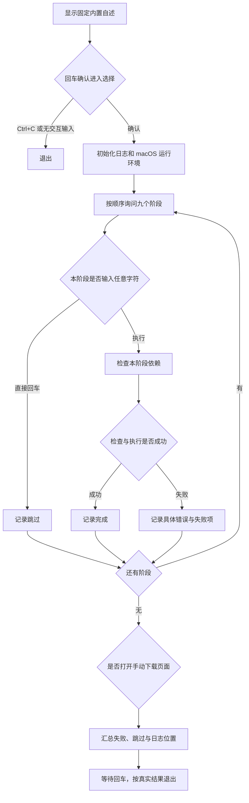
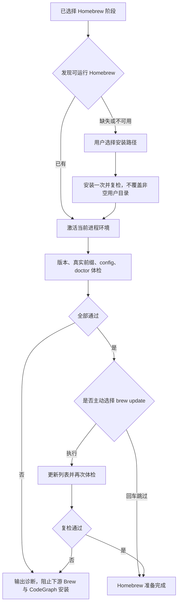
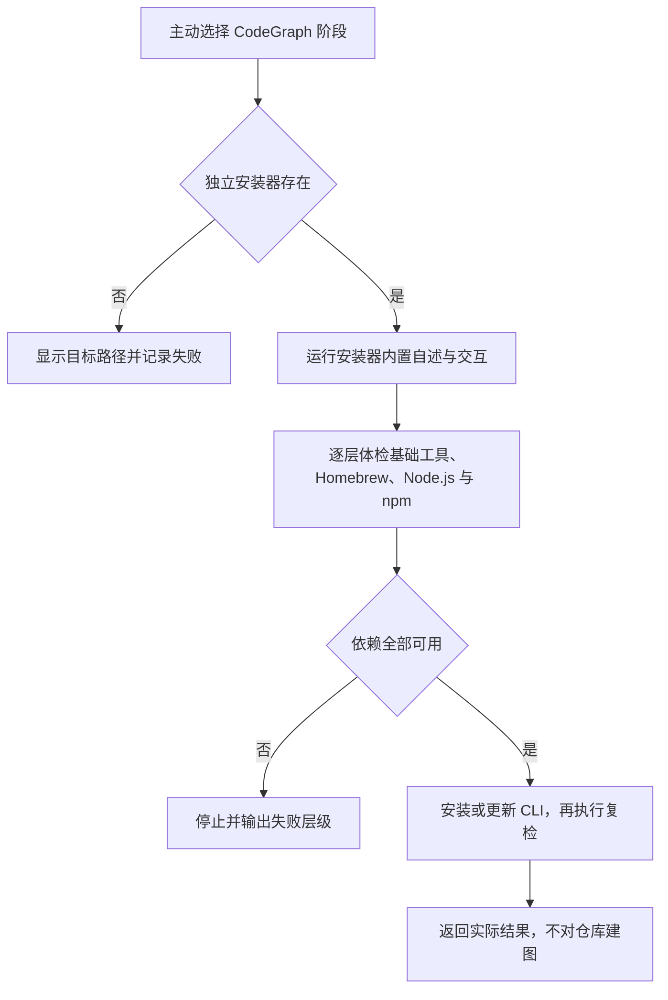

# `macOS` 新系统配置


<!-- jobs-toc:start -->
<!-- jobs-toc:source {"v":2,"token":"[toc]"} -->
<details>
<summary>📚 目录（点击展开 / 收起）</summary>

- [🔥 前言](#jobs-toc-heading-1)
- [一、九个可选阶段](#stages)
- [二、执行流程](#flow)
- [三、Homebrew 健康门禁](#homebrew)
- [四、CodeGraph 与 codemap](#codegraph)
- [五、Jobs 工作区与配置同步](#jobs-config)
- [六、日志、排查与验证](#troubleshooting)
- [七、Git 子模块脚本](#git-submodule-scripts)
  - [【MacOS】⏬下载配置当前Git子模块（可向下同步递归）.command](#jobs-toc-heading-9)
  - [【MacOS】🧭更新引用Git父仓=\>子仓.command](#jobs-toc-heading-10)
  - [【MacOS】🧾更新gitmodules.command](#jobs-toc-heading-11)
- [八、实际目录结构](#repository-layout)
- [九、新系统配置脚本](#repository-script-flows)
  - [【MacOS】🆕新系统配置.command](#jobs-toc-heading-14)

</details>
<!-- jobs-toc:end -->

[实际目录结构](#repository-layout) · [Git 子模块脚本](#git-submodule-scripts) · [新系统配置流程](#repository-script-flows)

---

## <span id="jobs-toc-heading-1" data-jobs-toc="v2">🔥 <font id=前言>前言</font></span><!-- jobs-toc:heading-end -->

[**Git**](https://git-scm.com/) 子模块脚本的用途与执行顺序见[专章说明](#git-submodule-scripts)。

<strong id="readonly-submodule-mode">先选用途：只拉取电脑默认跟随分支最新，子仓保持本地分支</strong>

| 启动选择 | 版本依据 | 是否写入父仓提交 |
| --- | --- | --- |
| 只拉取，默认 | 更新当前父仓明确的远程上游，再逐层跟随子仓目标分支最新提交，保持本地跟踪分支 | 不暂存、不提交、不推送 |
| 维护子模块，显式选择 | 按本仓清单及原有菜单，把所选子树更新到各自远端目标分支最新 | 沿用 `AUTO_PARENT_COMMIT` / `AUTO_PARENT_PUSH` 原有开关 |

启动第一屏显示同步策略版本 `2026.10.21`。新电脑须先取得并运行带此版本号的入口；另一台电脑上的本地修改不会自动更新到新电脑。任一仓库拉取、分支切换或递归校验失败时，本轮不能视为全部完成；处理日志中的具体路径后重新运行。

只拉取模式从脚本所在仓库向下递归处理全部已登记子模块；不向上处理，不使用清单新增关联，也不把子仓最新提交自动提交回父仓。各层优先使用直接父仓 `.gitmodules` 的显式 `branch`，`.` 继承该层计划更新后的直接父仓分支；未配置时读取该子仓远端默认分支。首次下载和已有游离 HEAD 都会恢复或创建对应本地跟踪分支，获取最新提交并快进；成功结束时子仓显示实际分支名。每层相对 URL 随当前父仓的下载线路解析。只拉取模式只依赖系统 Git、zsh、Perl 等现有工具，不进入维护模式的 Homebrew / fzf 安装流程。

子仓源码、未跟踪内容、已暂存 gitlink、未完成操作或本地独有提交会报出具体路径并停止；不会强制覆盖或丢弃独有的游离提交，父仓 `YES` 不扩散到子仓。当前父仓自己的源码改动或本地独有提交，仍须红字列明并精确输入 `YES` 才舍弃。目标分支不存在、远端默认分支无法确定或最新提交获取失败时，停止并报告对应仓库与来源；不会把旧 gitlink SHA 当作最新分支结果。

只拉取模式在入口仓已有本地分支时仍要求明确上游。入口仓自身处于游离 HEAD 时，先使用直接父仓 `.gitmodules` 的显式 `branch`，`.` 继承直接父仓当前分支；无配置时读取 `origin` 或唯一远端的默认分支。已有目标本地分支须明确跟踪所选远端的同名分支；先获取最新提交，预检整棵子树与提交历史，并复查确认期间的状态，再恢复或创建本地跟踪分支。入口源码未提交、需继承分支时直接父仓同样游离、目标不明、目标分支无法快进或存在未受引用保护的独有游离提交时停止；普通父仓的 `YES` 不授权舍弃这些提交。

`REMOTE_NAME` 等原有清单参数只用于维护模式。设置 `DRY_RUN=1` 时，默认只拉取会停止并提示选择维护演练，不能忽略演练标志后执行真实更新。未初始化但存在旧 Git 缓存的空工作树须先恢复，脚本不会覆盖缓存内索引或独有提交。

下文关于清单新增、多选、可切换同步深度、目录清理及自动提交的既有流程，均指显式选择的**维护模式**。只拉取模式默认向下递归到分支最新，不使用这些写入父仓的开关；子仓最新提交与父仓 gitlink 可能不同，父仓会显示待审阅的子模块指针改动。两种模式都保留各仓独立清单和来源显示；只拉取日志带运行时间与进程号，终端会输出实际路径。

维护模式补齐或新增登记时，不自动写入 `branch = main`；已有 `branch` 与缺省状态均保留。显式 `branch` 严格指定目标分支，`.` 继承直接父仓分支；未配置时跟随子仓远端默认分支。目标不存在、直接父仓分支无法确定或远端默认分支无法确定时停止。

<strong id="submodule-quick-look">父子仓多平台地址速览</strong>

当前 `./.gitmodules` 中，同组织、同仓名的子仓使用相对地址，例如：

```ini
[submodule "💻JobsCodexConfigs"]
    path = 💻JobsCodexConfigs
    url = ../JobsCodexConfigs.git
    branch = main
```

下表展示原生 Git 从父仓地址解析相对 URL 的结果，前提是全新克隆且没有本地 URL 覆盖。前两行来自本地已配置的 [**GitHub**](https://github.com) / [**Gitee**](https://gitee.com) 远端；自建平台仅为结构示例，未部署。

| 平台 | 父仓克隆地址 | 子仓解析地址 |
| --- | --- | --- |
| GitHub | `git@github.com:JobsKits/JobsConfigOS.git` | `git@github.com:JobsKits/JobsCodexConfigs.git` |
| Gitee | `git@gitee.com:JobsGo/JobsConfigOS.git` | `git@gitee.com:JobsGo/JobsCodexConfigs.git` |
| 自建平台，仅结构示例 | `ssh://git@git.example.com:2222/team/JobsConfigOS.git` | `ssh://git@git.example.com:2222/team/JobsCodexConfigs.git` |

`path` 是本地目录，`url` 是远端仓库位置；相对 URL 跟随父仓默认远端的平台、组织、协议与端口，前提是该平台已有对应子仓及父仓锁定的提交。已有克隆须核对默认远端和本地子模块配置，仅新增 remote 不会切换线路。

本仓 `🍎JobsCodeSnippets` 是明确例外：两平台仓名不同，使用已确认的 Gitee HTTPS 地址，不能机械替换平台或仓名。

```ini
[submodule "🍎JobsCodeSnippets"]
    path = 🍎JobsCodeSnippets
    url = https://gitee.com/JobsGo/jobs-code-snippetsJobsCodeSnippets.git
    branch = main
```

这个仓库提供可选择阶段的 macOS 新系统初始化入口。先展示脚本内置自述并等待回车，随后每个阶段都采用“直接回车跳过，输入任意字符后回车执行”。缓存删除另需精确输入 `YES`。

`【MacOS】⏬下载配置当前Git子模块（可向下同步递归）.command` 维护本仓库的子模块。[**Sourcetree**](https://www.sourcetreeapp.com/) 脚本统一使用上一级的 [SourceTree.command](../SourceTree.command/README.md)，由总仓管理；本仓库不再重复克隆或登记该脚本库。

当前入口采用同名完整目录：

```text
./【MacOS】🆕新系统配置.command/
├── 【MacOS】🆕新系统配置.command
└── README.md
```

从当前仓库目录运行：

```shell
zsh './【MacOS】🆕新系统配置.command/【MacOS】🆕新系统配置.command'
```

完整交互、依赖、风险、日志和故障说明见[新系统配置 README](./【MacOS】🆕新系统配置.command/README.md)。安装 CodeGraph CLI 与建立仓库代码地图分别执行，安装阶段不会隐式创建 `.codegraph/` 或修改 Codex 配置。

**下载脚本的 Gitee 传输规则：** `【MacOS】⏬下载配置当前Git子模块（可向下同步递归）.command` 在本次运行中，将 `git@gitee.com:`、`ssh://git@gitee.com/`、`ssh://git@gitee.com:22/` 开头的标准地址统一通过 `https://gitee.com/` 访问，保留账号、真实仓名和分支；即使设置 `GIT_URL_STYLE=ssh`，这类 Gitee 地址仍使用 HTTPS。各层首次克隆和后续拉取都继承该规则，历史子模块中的 SSH 地址无需新电脑先配置 SSH 密钥。

规则通过追加进程级 `GIT_CONFIG_COUNT` / `url.https://gitee.com/.insteadOf` 配置传给子进程，不写入全局 Git 配置，也不依赖其它工程路径。GitHub、其它主机及非 `22` 的自定义 SSH 端口保持原规则。克隆或递归更新失败会返回非零状态，停止本轮同步并保留错误；不会再输出该项同步成功。各仓清单与浅克隆参数保留；全量同步默认逐仓复用已有工作区，空或缺失目录才首次克隆，不批量删除旧仓名目录、多层子树或缓存。未提交内容须逐仓处理，精确 `YES` 仅放弃当前仓自己的内容。

## 一、<span id="stages">九个可选阶段</span> <a href="#前言" style="font-size:17px; color:green;"><b>🔼</b></a> <a href="#🔚" style="font-size:17px; color:green;"><b>🔽</b></a>

| 阶段 | 配置项 | 当前行为 |
| --- | --- | --- |
| 1 | Command Line Tools（CLT） | 已可用则复用；缺失时打开系统安装窗口，安装完成后需要重跑；完整 Xcode 可用时处理 License |
| 2 | Xcode 模拟器配件 | 先验证 Xcode，缓存删除须另输入 `YES`，随后下载 iOS 平台 |
| 3 | oh-my-zsh | 保留已有目录；缺失时执行官方安装器，不自动切换 Shell |
| 4 | Homebrew | 安装或复用，进行健康体检；`brew update` 另行确认，不执行全量升级或清理 |
| 5 | Homebrew 开发工具 | 使用前再次体检，补装源码数组中的 formula / cask，并处理 Git LFS 与原有 Git 全局参数 |
| 6 | CodeGraph 代码地图 CLI | 调用相邻 `JobsCommand@iOS` 的独立安装器，逐层体检依赖并复检 CLI |
| 7 | npm / quicktype | 先验证 Node.js 版本与实际执行、npm 版本，再按原有 `sudo npm install -g quicktype` 方式安装 |
| 8 | gem / CocoaPods | 验证 RubyGems 后，按原有 `sudo gem install cocoapods` 方式安装 |
| 9 | Jobs 环境配置 | 准备 Jobs 软件仓，运行本仓 `🌍JobsMacEnvVarConfigs` 的安装入口 |

手动下载页面另行询问；确认后才打开 [**Visual Studio Code**](https://code.visualstudio.com)、[**Android Studio**](https://developer.android.com/studio?hl=zh-c) 与 [**Python**](https://www.python.org) 官网。阶段失败会记入摘要，后续独立阶段仍可以选择；最后返回非零退出码，不把失败标记成完成。

## 二、<span id="flow">执行流程</span> <a href="#前言" style="font-size:17px; color:green;"><b>🔼</b></a> <a href="#🔚" style="font-size:17px; color:green;"><b>🔽</b></a>



脚本 `main()` 只负责按顺序编排函数；阶段选择由 `run_optional_stage` 统一处理。关键函数与文档对应关系：

| 函数 | 职责 |
| --- | --- |
| `show_script_intro_and_wait` | 固定内置自述与首次确认，确认前不写日志或执行安装 |
| `stage_homebrew` / `check_homebrew_health` | Homebrew 安装选择、环境激活与健康门禁 |
| `stage_brew_packages` | 健康通过后补装开发工具 |
| `stage_codegraph` | 检查独立安装器是否存在，保留终端交互并传播返回值 |
| `stage_jobs` | 软件仓准备与当前环境配置仓库安装入口 |
| `finish_summary` / `finish_and_wait` | 汇总真实结果并返回失败状态 |

## 三、<span id="homebrew">Homebrew 健康门禁</span> <a href="#前言" style="font-size:17px; color:green;"><b>🔼</b></a> <a href="#🔚" style="font-size:17px; color:green;"><b>🔽</b></a>

发现 [**Homebrew**](https://brew.sh/) 时，先验证候选可执行文件与实际前缀，兼容 Apple Silicon、Intel 和用户目录安装。共享安装只读不等于未安装；不会因此重复安装。

确实需要安装时，精确输入大写 `YES` 选择系统标准目录，其它输入或直接回车选择当前用户的 `.local/homebrew`。系统安装器负责实际权限验证与密码提示；用户目录安装不使用 `sudo`。选定路径失败立即停止，不自动换到另一路径。只有新安装才保存受控 shellenv 块，并立即激活当前进程。



`brew doctor` 非零时输出诊断并停止该依赖链。开发工具阶段在执行任何 Brew 安装前再次体检。脚本不执行全量 `brew upgrade` 或 `brew cleanup`；软件列表更新也必须主动确认。

## 四、<span id="codegraph">CodeGraph 与 codemap</span> <a href="#前言" style="font-size:17px; color:green;"><b>🔼</b></a> <a href="#🔚" style="font-size:17px; color:green;"><b>🔽</b></a>

[**CodeGraph**](https://github.com/colbymchenry/codegraph) 的本地安装器位于相邻仓库：

```text
../JobsCommand@iOS/配置相关/
└── 【MacOS】⚙️安装代码地图CodeGraph.command/
    ├── 【MacOS】⚙️安装代码地图CodeGraph.command
    └── README.md
```

脚本按自身位置定位安装器，与启动目录无关。缺失时明确显示路径并失败，不猜测远端地址或临时下载替代脚本。依赖链中的基础工具、[**Homebrew**](https://brew.sh/)、[**Node.js**](https://nodejs.org/)、[**npm**](https://www.npmjs.com/) 和 [**CodeGraph**](https://github.com/colbymchenry/codegraph) 由独立安装器逐层体检、按需安装和复检，详见[安装器说明](../JobsCommand@iOS/配置相关/【MacOS】⚙️安装代码地图CodeGraph.command/README.md)。



终端命令 `codemap` 由[环境配置仓库](./🌍JobsMacEnvVarConfigs/README.md)的脚本目录注册。Jobs 环境配置阶段会执行本仓的环境配置安装入口。

```shell
# 对当前目录建立代码地图。
codemap

# 对手动输入或拖入的目录建立代码地图。
codemap './目标项目'
```

目录包含空格或中文时保留引号，或保留终端拖入路径自动生成的转义。地图生成在目标目录的 `.codegraph/`，不会因 CLI 安装自动生成。

## 五、<span id="jobs-config">Jobs 工作区与配置同步</span> <a href="#前言" style="font-size:17px; color:green;"><b>🔼</b></a> <a href="#🔚" style="font-size:17px; color:green;"><b>🔽</b></a>

Jobs 阶段使用本仓 `./🌍JobsMacEnvVarConfigs/install.command/install.command`，不再另行克隆旧名称的环境配置仓库。安装入口缺失时提示先准备子模块。

[**JobsSoftware.MacOS**](https://github.com/JobsKits/JobsSoftware.MacOS) 仍准备在当前用户桌面的 `JobsKits` 工作目录中。缺失时克隆；已有干净工作区只做快进更新；存在未提交改动时保留并跳过 pull；目标存在但不是有效仓库时失败，不覆盖。

仓库子模块下载、父子仓关联维护仍由各自的根目录脚本负责。新系统入口不创建提交或推送，不改写子模块远端。

## 六、<span id="troubleshooting">日志、排查与验证</span> <a href="#前言" style="font-size:17px; color:green;"><b>🔼</b></a> <a href="#🔚" style="font-size:17px; color:green;"><b>🔽</b></a>

入口日志位于系统临时目录，文件名为 `【MacOS】🆕新系统配置.log`，每次确认运行后重新初始化，运行时打印实际路径。普通业务命令输出和阶段结果同步记录。CodeGraph 与环境配置子安装器保留自己的终端交互和独立日志；父入口记录调用目标与退出结果。

| 现象 | 排查方向 |
| --- | --- |
| 没有可交互输入 | 在 macOS 终端直接运行，不能用管道答案跳过确认 |
| CLT 尚未准备好 | 完成系统安装窗口，再选择需要 CLT 的阶段重试 |
| Xcode 模拟器步骤失败 | 检查完整 Xcode 的选择、首次初始化、Apple 网络与磁盘空间 |
| Homebrew 体检失败 | 根据 `doctor` 诊断修复，修复前不继续 Brew / CodeGraph 安装 |
| CodeGraph 安装器缺失 | 核对相邻仓库布局与提示路径 |
| 子模块入口缺失 | 准备 `🌍JobsMacEnvVarConfigs` 子模块 |
| 软件仓跳过 pull | 本地存在未提交改动，工作区已保留 |
| quicktype / CocoaPods 失败 | 查看 Node.js / npm 或 RubyGems 体检与管理员授权输出 |
| GitHub 或安装源不可访问 | 检查网络、代理与官方服务，按失败阶段重试 |

选择部分阶段可能请求管理员密码、弹出系统窗口、下载平台或修改用户配置。Xcode 缓存删除另外要求 `YES`。CocoaPods CLI 安装成功与具体本地 Pod 编译成功属于不同验证范围；本入口不会运行 Pod 构建或 `pod lib lint`。

验证包含 `zsh -n`、入口结构检查和隔离假命令测试，覆盖 Homebrew 健康顺序、doctor 失败门禁、安装器缺失、子安装器调用及退出状态传播。没有通过验证流程真实安装软件、接受系统协议、删除缓存或改变用户工具链。

## 七、<span id="git-submodule-scripts">Git 子模块脚本</span> <a href="#前言" style="font-size:17px; color:green;"><b>🔼</b></a> <a href="#🔚" style="font-size:17px; color:green;"><b>🔽</b></a>

### <span id="jobs-toc-heading-9" data-jobs-toc="v2">[【MacOS】⏬下载配置当前Git子模块（可向下同步递归）.command](./【MacOS】⏬下载配置当前Git子模块（可向下同步递归）.command)</span><!-- jobs-toc:heading-end -->


> **目的：** 默认递归拉取已登记子模块目标分支的最新提交，保持本地跟踪分支；显式维护模式保留清单与登记能力。

- 启动时回车默认进入[只拉取模式](#readonly-submodule-mode)，先预检本地状态，再更新当前父仓并逐层快进到子仓目标分支最新提交；恢复已有游离 HEAD，不提交、不推送。
- 显式选择维护模式后，按以下原有清单和菜单流程处理。

* 确认自述后读取脚本清单、检查远端，尝试拉取父仓。
  * 父仓有未提交改动：跳过父仓拉取，继续处理子仓。
* 在主菜单选择同步范围；“切换同步深度”可在默认“向下递归”和“仅直属子模块”之间切换，当前深度适用于各同步动作。
  * 全量同步：逐项同步清单内全部目标，按目录状态复用或首次克隆。
  * 只更新已有：更新清单内已存在的子仓；一个都没有时转全量同步。
  * 指定子模块：回车勾选或取消，空格确认开始。
  * 添加地址：输入新仓地址，自动用仓名作为目录，本轮登记并同步。
* 补齐关联配置，检查并处理目标子仓目录。
  * 目录为空或缺失：首次克隆；已有有效 Git 工作区：保留目录、缓存及后代，直接更新。
  * 已有 `modules/` 缓存时先核验并恢复空工作区；非 Git 非空目录保护并停止。
  * 子仓有未提交、已暂存或未跟踪内容：红字加粗显示该仓绝对路径并循环等待；精确输入 `YES` 只放弃当前仓自己的未提交内容，或在外部处理后回车复检。其它输入继续复检；无交互或输入结束则停止。
* 拉取并快进到远端目标分支最新提交：优先使用该层 `.gitmodules` 显式 `branch`，`.` 继承直接父仓分支；未设置时读取该子仓远端默认分支；显式目标分支不存在时立即停止，不回退其它分支。
  * 已有目标本地分支只允许快进，领先远端或发生分叉时停止并保留本地提交；缺少目标分支时创建本地跟踪分支。
* 按当前深度同步：默认逐层读取所选子仓下的 `.gitmodules`，将已登记后代同步到各自远端目标分支最新提交；仅直属模式不下载或更新下层代码。
  * 只处理本层所选子树，不向上扫描，也不接管未登记的嵌套仓库。
  * 递归更新本层前先检查当前已有后代；各仓单独确认，子模块 HEAD 与父仓 gitlink 的普通差异不作为源码未提交反复提示。
  * `YES` 清理仅作用于当前仓：`reset --hard HEAD` 与 `clean -fd`；保留忽略文件和独立嵌套 Git 仓，残留冲突须外部处理后复检。
  * `PRUNE_STALE_GITMODULES` 默认 `0`，保留清单外旧登记；主动设为 `1` 时，每个旧登记另用红字加粗列明目录和后代删除范围，逐项精确输入 `YES` 才删除，其它输入、输入结束或非交互则停止；演练只展示，删除前仍逐仓检查已有后代。
  * 深层只下载更新，不自动暂存或提交其父仓的 gitlink；递归后这些父仓可能显示子模块指针改动，保留待审阅。
* 整理入口父仓 Git 元数据与来源日志。
* 默认自动提交入口父仓的关联变化，不自动推送。
  * 设置 `AUTO_PARENT_COMMIT=0`：跳过提交；`AUTO_PARENT_PUSH=1`：启用父仓推送。

### <span id="jobs-toc-heading-10" data-jobs-toc="v2">[【MacOS】🧭更新引用Git父仓=>子仓.command](./【MacOS】🧭更新引用Git父仓=%3E子仓.command)</span><!-- jobs-toc:heading-end -->

> **目的：** 修复目录改名、旧路径残留或元数据指向错误，让父仓关联符合当前磁盘布局。

* 扫描父仓第一层实际带 `.git` 的子目录，读取远端和已有登记。
  * 远端缺失、元数据归属不明或属于链接工作树：停止修复。
* 展示磁盘目录、父仓状态与清理计划，确认后备份关联状态。
  * 直接回车：跳过；输入任意字符后回车：执行；`--dry-run`：只预览。
* 按现存目录对齐 `.gitmodules`，保留仍存在条目的 URL、分支及扩展字段。
  * 目录缺失，包括尚未下载：移除旧登记和旧子模块指针，磁盘文件保留。
* 修复可证明失效的工作树指向，暂存各子仓当前提交号，用官方命令归集元数据并补齐父仓本地登记。
* 核对磁盘目录、清单和父仓子模块指针是否一致，输出状态；不拉取代码、不提交、不推送。

### <span id="jobs-toc-heading-11" data-jobs-toc="v2">[【MacOS】🧾更新gitmodules.command](./【MacOS】🧾更新gitmodules.command)</span><!-- jobs-toc:heading-end -->

> **目的：** 将新放入的直属子仓完整纳入父仓子模块管理，保留已有登记与指针。

* 读取已有登记，扫描直属子仓，预检远端、提交、索引和元数据冲突。
  * 有冲突或缺少必要信息：停止，展示问题。
* 生成增量计划，保留已有 URL、分支、扩展字段、子模块指针和暂缺目录登记。
  * `--dry-run` 或 `DRY_RUN=1`：只预览，不执行关联写入。
* 确认计划后备份关联配置和父仓索引。
  * 直接回车：跳过；输入任意字符后回车：执行。
* 补齐 `.gitmodules` 和缺失的子模块指针，初始化本地登记，将元数据归集到父仓。
* 核验父子关系和子仓提交号；仅暂存必要关联，不联网拉取、不提交、不推送。

## 八、<span id="repository-layout">实际目录结构</span> <a href="#前言" style="font-size:17px; color:green;"><b>🔼</b></a> <a href="#🔚" style="font-size:17px; color:green;"><b>🔽</b></a>

```text
JobsConfigOS/
├── README.md / .gitmodules                 # 父仓说明与子模块登记
├── assets/ / icon.png / LICENSE
├── ⏬JobsSoftware.MacOS/                    # 独立 Git 仓：软件包与下载辅助
├── ⚙️VScodeConfigs/                         # 独立 Git 仓：编辑器配置父仓
├── 🌍JobsMacEnvVarConfigs/                  # 独立 Git 仓：终端环境与命令
├── 🍎JobsCodeSnippets/                      # 独立 Git 仓：Xcode 代码片段
├── 💻JobsCodexConfigs/                      # 独立 Git 仓：Codex 配置标准源
├── 📒CodexByObsidian/                       # 独立 Git 仓：记忆 Vault 与同步入口
├── 🔨JobsConfigHotKeyByHammerspoon/         # 独立 Git 仓：桌面热键
├── 🦞JobsInstallOpenClaw/                    # 独立 Git 仓：OpenClaw 安装入口
├── 【MacOS】⏬下载配置当前Git子模块（可向下同步递归）.command
├── 【MacOS】🧭更新引用Git父仓=>子仓.command
├── 【MacOS】🧾更新gitmodules.command
└── 【MacOS】🆕新系统配置.command/
    ├── 【MacOS】🆕新系统配置.command
    └── README.md
```

子仓内部的脚本由各自根 `README.md` 说明；本仓直接维护的三个 Git 脚本见[第七章](#git-submodule-scripts)。

| 独立子仓 | 根说明 |
| --- | --- |
| 软件包与下载辅助 | [⏬JobsSoftware.MacOS](./⏬JobsSoftware.MacOS/README.md) |
| 编辑器配置父仓 | [⚙️VScodeConfigs](./⚙️VScodeConfigs/README.md) |
| 终端环境与命令 | [🌍JobsMacEnvVarConfigs](./🌍JobsMacEnvVarConfigs/README.md) |
| Xcode 代码片段 | [🍎JobsCodeSnippets](./🍎JobsCodeSnippets/README.md) |
| Codex 配置标准源 | [💻JobsCodexConfigs](./💻JobsCodexConfigs/README.md) |
| 永久记忆与同步 | [📒CodexByObsidian](./📒CodexByObsidian/README.md) |
| 桌面热键 | [🔨JobsConfigHotKeyByHammerspoon](./🔨JobsConfigHotKeyByHammerspoon/README.md) |
| OpenClaw 安装入口 | [🦞JobsInstallOpenClaw](./🦞JobsInstallOpenClaw/README.md) |

## 九、<span id="repository-script-flows">新系统配置脚本</span> <a href="#前言" style="font-size:17px; color:green;"><b>🔼</b></a> <a href="#🔚" style="font-size:17px; color:green;"><b>🔽</b></a>

### <span id="jobs-toc-heading-14" data-jobs-toc="v2">[【MacOS】🆕新系统配置.command](./【MacOS】🆕新系统配置.command/【MacOS】🆕新系统配置.command)</span><!-- jobs-toc:heading-end -->

> **目的：** 按需准备新 Mac 的开发工具链，并安装 Jobs 终端环境。

* 阅读自述，确认后建立本次日志与阶段状态。
* 依次询问 Command Line Tools、Xcode 模拟器、Oh My Zsh 和 Homebrew 的准备项目。
  * 每阶段直接回车跳过，输入非空内容执行；模拟器缓存清理另需输入 `YES`。
* 继续按阶段选择开发软件、CodeGraph、quicktype 和 CocoaPods。
  * 依赖缺失时先处理前置条件；需要外部安装脚本或本地包时检查对应路径。
* 在 Jobs 配置阶段调用本地环境安装入口，并按提示准备软件目录和下载页面。
* 汇总各阶段结果及日志位置。
  * 单阶段失败会记录并继续后续独立阶段；有失败时最终返回失败状态。

<a id="🔚" href="#前言" style="font-size:17px; color:green; font-weight:bold;">我是有底线的➤点我回到首页</a>
