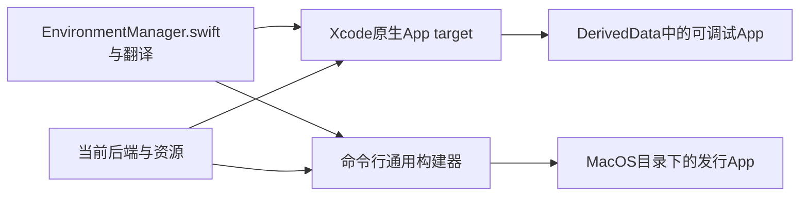

# Jobs 新系统配置管理面板


<!-- jobs-toc:start -->
<!-- jobs-toc:source {"v":2,"token":"[toc]"} -->
<details>
<summary>📚 目录（点击展开 / 收起）</summary>

- [🔥 前言](#%E5%89%8D%E8%A8%80)
- [一、用途与入口](#panel-entry)
- [二、操作方式](#operation)
- [三、卸载、后台与日志](#lifecycle-logs)
- [四、语言、主题与资源](#preferences-resources)
- [五、构建与检查](#build-validation)

</details>
<!-- jobs-toc:end -->

---

## 🔥 <span id="前言">前言</span>

管理入口与原终端入口分别保留，按当前所选组件执行安装或反安装。本目录现与 MacOS 工程和 App 就近存放；九套版本化源码/成品包集中到新系统配置的 [交付产物](../../交付产物/GUI源码与成品/README.md)，六 Unix 共用面板仍在独立的 `🆕新系统配置/安装面板/`。当前迁移与验证见 [目录与卸载入口资产盘点](../../../项目相关报告/新系统配置卸载入口资产盘点.md#panel-paths)。

**源码与工程：** [打开 Xcode 工程](../【MacOS】🧰新系统配置管理.xcodeproj) · [Swift 主源码](./Sources/EnvironmentManager.swift) · [命令行构建器](./【MacOS】构建安装面板.command/【MacOS】构建安装面板.command)。`.app` 是这些源码的构建产物，源码不存放在 `.app` 内。

## 一、<span id="panel-entry">用途与入口</span> <a href="#前言" style="font-size:17px; color:green;"><b>🔼</b></a> <a href="#🔚" style="font-size:17px; color:green;"><b>🔽</b></a>

原生 [**AppKit**](https://developer.apple.com/documentation/appkit) 面板用于按组件安装、预览计划和卸载本机开发环境。原终端安装入口继续独立使用。

| 入口 | 用途 |
| --- | --- |
| [新系统配置管理 App](../【MacOS】🧰新系统配置管理.app) | 双击打开 MacOS 组件管理面板 |
| [其它平台 GUI](../../README.md) | WindowsOS 与 Linux／FreeBSD 的本平台管理入口 |
| [原终端安装](../【MacOS】🆕新系统配置.command/【MacOS】🆕新系统配置.command) | 保留原来的终端安装流程 |
| [终端反安装](../【MacOS】↩️卸载新系统配置.command/【MacOS】↩️卸载新系统配置.command) | 多选受管组件、预览计划并明确确认后卸载 |
| [构建脚本](./【MacOS】构建安装面板.command/【MacOS】构建安装面板.command) | 从本仓源码与当前后端生成 App |
| [原生 Xcode 工程](../【MacOS】🧰新系统配置管理.xcodeproj) | 直接编译、运行和调试同一份现行Swift源码 |
| [源码与成品交付打包器](./PackageGuiDeliverables.py/README.md) | 为两套Mac面板与七套其它平台面板生成独立源码包、成品运行包与逐文件哈希清单 |
| [Xcode资源阶段](./【MacOS@Xcode】准备面板资源.command/README.md) | 将当前后端、翻译、图标与构建收据打入本次构建产物 |
| [面板源码](./Sources/EnvironmentManager.swift) | 原生交互、后台任务、日志与偏好 |
| [翻译资源](./Resources/PanelTranslations.json) | 完整的十种界面语言 |

## 二、<span id="operation">操作方式</span> <a href="#前言" style="font-size:17px; color:green;"><b>🔼</b></a> <a href="#🔚" style="font-size:17px; color:green;"><b>🔽</b></a>

- 打开面板，等待组件状态读取完成。首次进入为空选；可搜索、全选当前结果、清空全部勾选，也可逐项勾选。

- 选择“安装”或“卸载”。切换操作保留当前勾选；列表显示名称、说明、存在状态或本轮执行结果。

- 可先点“预览计划”。预览使用后端 `--dry-run`，会显示实际组件和依赖计划。

- 点击“安装所选组件”或“卸载所选组件”，核对汇总后明确确认。确认框默认取消；取消不会启动业务。

- 查看实时日志和逐项结果。面板每轮把完整选中集合交给后端一次，由后端处理依赖次序、互斥锁和公共支持；后端事件更新列表，真实退出码保留在日志中。

安装确认包含当前任务必要依赖的自动补齐与修复授权。后端先定位缺失／损坏层，沿当前选择的依赖链定向处理，刷新当前进程环境并复检，通过后自动续行。健康依赖复用；网络获取失败持续退避重试且可取消，确定的权限、认证、磁盘或配置冲突会明确停止下游。目录读取、计划预览及卸载不触发自动修复，也不升级无关工具。

[**Homebrew**](https://brew.sh/) 缺失时，直接选择它，或选择 REA、quicktype、CodeGraph、CocoaPods、Git LFS 配置等可能需要它的组件，安装确认框都会提供“若需要 Homebrew”的位置选择。当前用户目录路线明确传参；系统路线保留原终端权限入口。后端仅在当前任务确实缺少可用来源时消费这项许可；已有健康运行时不因此另装 Homebrew。

[**REA**](https://github.com/morluto/rea) 组件安装官方 `rea-agents` npm 运行时；客户端 MCP／Skill 注册和原生分析引擎按需配置，界面不把它们计作已完成安装。

## 三、<span id="lifecycle-logs">卸载、后台与日志</span> <a href="#前言" style="font-size:17px; color:green;"><b>🔼</b></a> <a href="#🔚" style="font-size:17px; color:green;"><b>🔽</b></a>

- 卸载只撤回后端能核对归属和当前状态的受管变更。原有、共享、后续已修改或缺少恢复依据的对象保留，并报告未完成原因。非零退出码显示失败或未完成。
- 安装、卸载和计划同一时刻只运行一轮。任务开始后关闭窗口会退到状态栏并继续；任务结束仍保留状态栏入口。进行中禁止完全退出，面板不强杀安装进程。
- 实际安装时可“停止后续安装”：后端在当前安全步骤结束后停止，不再启动后续组件；等待依赖与下载重试也可响应停止。已完成、已失败、已停止和未开始分别显示，停止不撤回本轮已完成的变更。
- 空闲关闭窗口可选择退到后台、完全退出或取消。后台入口恢复同一窗口、选择和日志。
- 日志可选中文字复制，可复制可见日志或定位完整日志文件。手动滚动、翻页会暂停追尾，重新勾选“自动滚动”恢复。
- 每轮完整日志独立保存在当前用户的 Application Support 内 `JobsEnvironmentManager/Logs/system`，目录和文件分别使用私有权限。窗口最多保留约一百万字符，完整文件继续保留。日志写入失败会提示，窗口日志仍可复制。

## 四、<span id="preferences-resources">语言、主题与资源</span> <a href="#前言" style="font-size:17px; color:green;"><b>🔼</b></a> <a href="#🔚" style="font-size:17px; color:green;"><b>🔽</b></a>

支持简体中文、繁体中文、藏文、英文、日文、法文、西班牙文、德文、俄罗斯文、韩文，以及语言跟随系统。支持白天、黑夜、跟随系统主题；偏好保存在当前面板自己的用户配置域，不与环境配置面板混用。切换语言或主题保留选择和日志。

组件包名、命令名和路径保留技术名称。非中文界面的组件说明使用对应语言的类别说明；后端原始日志保持原文便于排查。

App 内包含二进制、翻译、后端与环境配置资源，运行时从 Bundle 定位，不依赖构建机路径或源码目录。可单独复制整个 App 再打开。图标来源为本仓已有的 [icon.png](../../../icon.png)，构建时转换为 ICNS；状态栏复用同一图标。包内 `Resources/BuildReceipt.plist` 记录实际构建时间、profile 与面板源码摘要；单独刷新资源时以 `packagedAtUTC` 另记打包时间。`Resources/Payload.sha256` 记录资源摘要，供核对当前产物与源码，不用目录修改时间推断版本。

## 五、<span id="build-validation">构建与检查</span> <a href="#前言" style="font-size:17px; color:green;"><b>🔼</b></a> <a href="#🔚" style="font-size:17px; color:green;"><b>🔽</b></a>

优先双击 [Xcode工程](../【MacOS】🧰新系统配置管理.xcodeproj)，选择同名Scheme，目标为My Mac，使用 `⌘B` 编译、`⌘R` 运行；Archive也使用同一原生App target。Debug带调试信息，Release使用优化和双架构配置。本地使用ad-hoc签名，不需要开发团队或下载依赖。

工程引用本目录 `Sources/EnvironmentManager.swift`，通过统一 `@main` 入口编译；翻译与后端从本仓现行资源打包，不复制一份平行UI源码。Xcode产物默认进入DerivedData，**不会覆盖**多平台 `MacOS/` 下现成发行App；需要更新发行App时使用下方独立构建器。源码引用和资源阶段使用相对路径，复制或换机需保留完整JobsConfigOS目录与所需环境子模块。



需已安装的 [**Xcode**](https://developer.apple.com/xcode/) 命令行工具，目标系统为 macOS 13 或以上。构建脚本不执行环境安装、卸载或自动安装编译工具。

```zsh
/bin/zsh ./【MacOS】构建安装面板.command/【MacOS】构建安装面板.command --yes
```

默认生成 Apple Silicon／Intel 通用 App，输出到 `../【MacOS】🧰新系统配置管理.app`（相对本说明）。`--native` 只构建当前架构；`--output /明确指定的目标.app` 可输出到其它实际目录。脚本检查目标 App 归属、构建互斥和运行状态，完整打包、签名、自测后再发布；运行中的管理面板需先等任务结束并完全退出。

在本说明所在目录运行以下只读检查：

```zsh
../【MacOS】🧰新系统配置管理.app/Contents/MacOS/JobsEnvironmentManager --self-test
../【MacOS】🧰新系统配置管理.app/Contents/MacOS/JobsEnvironmentManager --diagnose
../【MacOS】🧰新系统配置管理.app/Contents/MacOS/JobsEnvironmentManager --smoke-test-native
codesign --verify --deep --strict ../【MacOS】🧰新系统配置管理.app
```

`--self-test` 检查十语键、目录解析、重复 ID 拒绝、中文日志分帧和包内后端；`--diagnose` 还显示 Bundle 路径并只读查询后端目录；`--smoke-test-native` 使用独立临时偏好域初始化十语三主题控件，并以假后端检查忙碌、后台与停止请求后退出。上述检查不安装或卸载组件，原生控件检查通过不等于所有真实环境安装和人工点击均已验收。

构建使用本地 ad-hoc 签名并验证 Bundle 完整性。跨机首次打开仍由系统现行安全策略处理；程序不修改隔离属性或系统安全设置。

<a id="🔚" href="#前言" style="font-size:17px; color:green; font-weight:bold;">我是有底线的➤点我回到首页</a>
